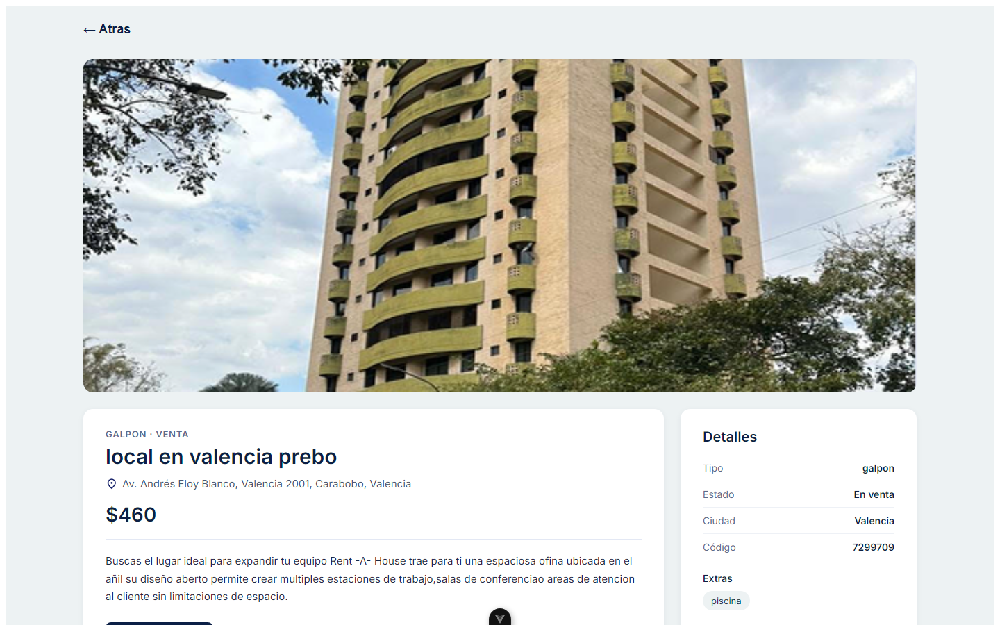
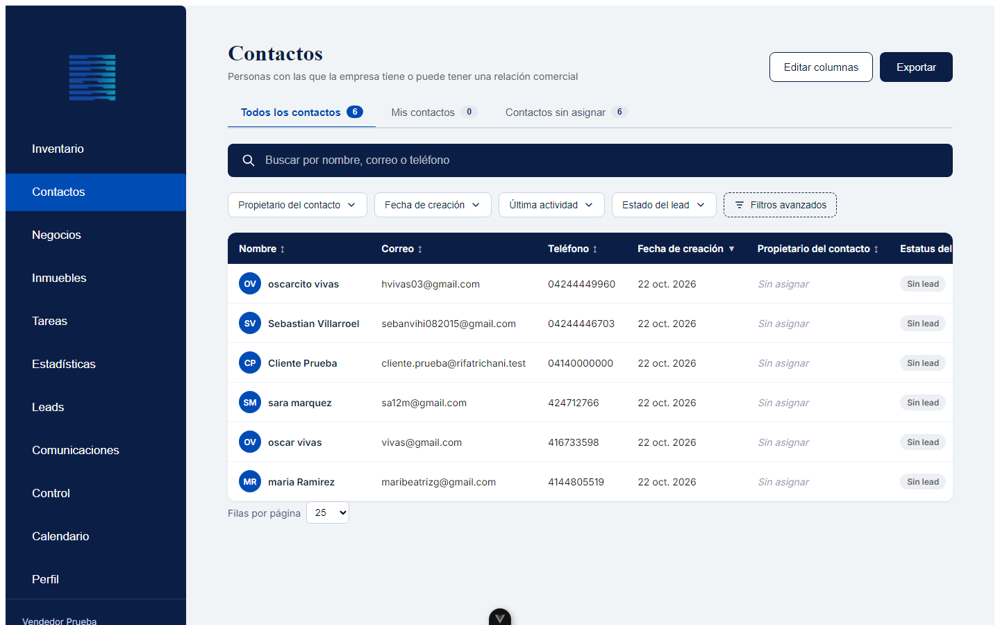
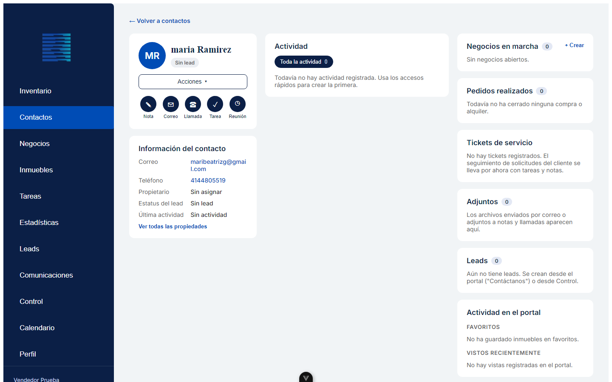
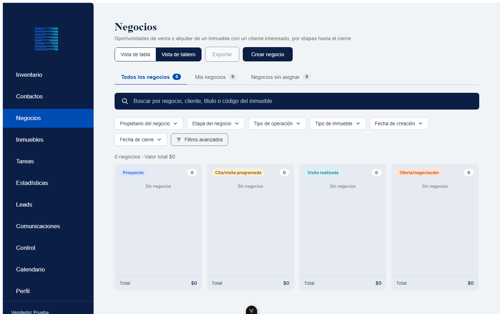
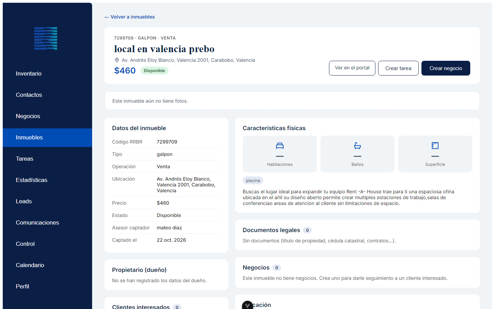
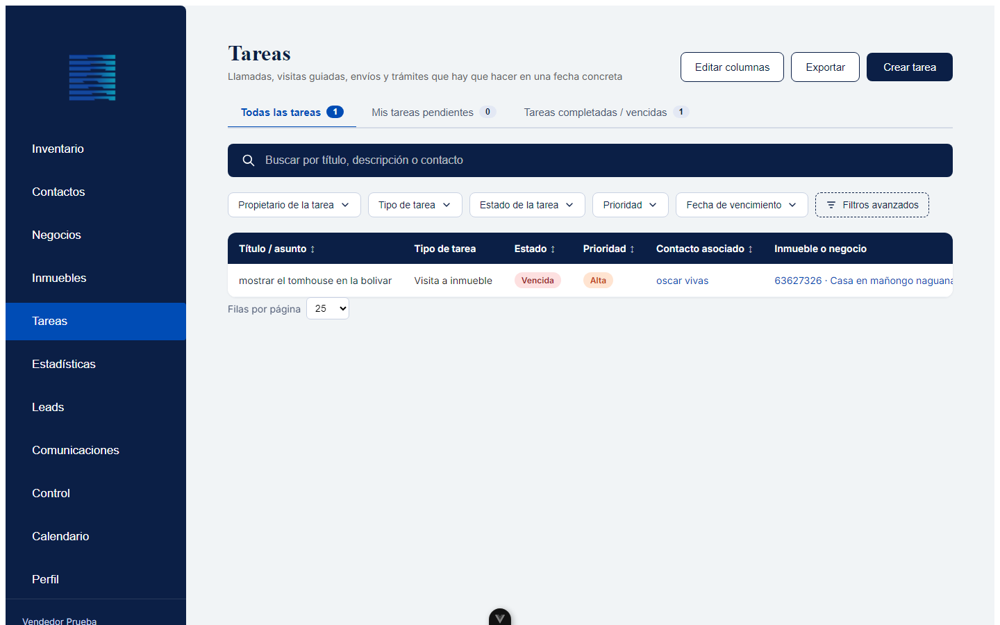
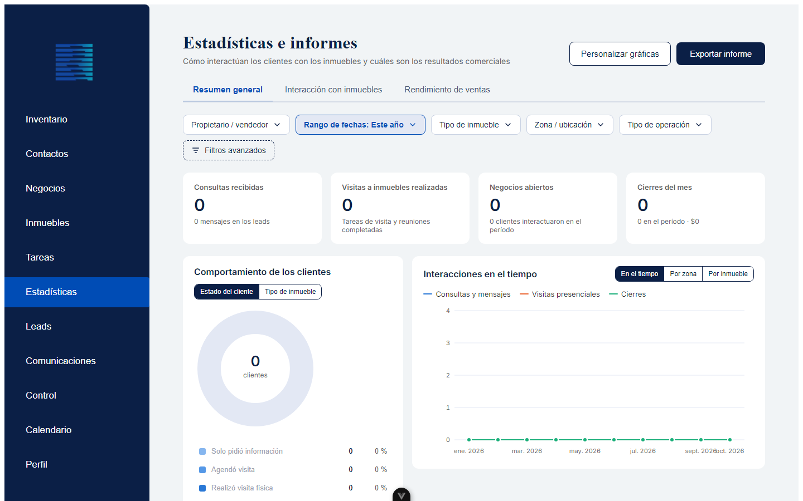

# Punto 4 — Cómo funciona: del portal al CRM

> Parte de la defensa del CRM de Rifat Richani Bienes Raíces. Puntos: [1. Por qué lo hicimos](01-por-que-lo-hicimos.md) · [2. Tecnologías](02-tecnologias.md) · [3. Metodología de negocio](03-metodologia.md) · **4. Cómo funciona**
>
> Las capturas son del entorno de prueba; por eso algunas tablas aparecen con pocos datos.

## Paso 1 — El cliente en el portal

- Busca por ciudad, tipo de propiedad, precio y operación (venta o alquiler).
- Ve la ficha del inmueble: galería de fotos, precio, características (habitaciones, baños, m², estacionamiento, piso), extras y mapa.
- Se registra y confirma su correo con un código.
- Guarda favoritos y pide información, lo que crea un **lead** en el CRM.



## Paso 2 — Del portal al CRM, sin pasos manuales

```
Se registra → aparece en «Contactos sin asignar» → un vendedor lo toma → crea un negocio con un inmueble → seguimiento hasta el cierre
```

- El vendedor entra por `/crm/login` con su cuenta de empleado.
- Cierra sesión desde el botón al pie de la barra lateral, que lo devuelve a la página principal.



## Los módulos del CRM

### Contactos
- Tabla con pestañas **Todos / Mis contactos / Sin asignar**, buscador, filtros (propietario, fechas, última actividad, estado del lead), filtros avanzados, edición de columnas y exportación a Excel o PDF.
- **Registro del contacto**, en tres columnas:
  - **Izquierda:** datos y propiedades del contacto, menú «Acciones» (ver todas las propiedades, crear negocio, asignar o liberar) y **accesos rápidos**: nota, correo (se envía de verdad, con adjuntos), llamada (con grabación), tarea y reunión.
  - **Centro:** **historial continuo**, filtrable por tipo; las tareas y reuniones pendientes van primero.
  - **Derecha:** negocios en marcha, pedidos realizados, tickets, adjuntos, leads y actividad en el portal (favoritos y vistas).



### Negocios
- Pestañas **Todos / Mis negocios / Sin asignar**, con **vista de tabla** y **vista de tablero (pipeline)**.
- En el tablero, cada etapa es una columna: las tarjetas se **arrastran** para cambiar de etapa y cada columna muestra el **monto acumulado**.
- Filtros: propietario, etapa, tipo de operación, tipo de inmueble, fecha de creación y fecha de cierre; filtros avanzados por rango de valor, cliente y código.
- Página del negocio: barra de etapas, datos, inmueble con fotos, cliente e historial de seguimiento.



### Inmuebles
- Pestañas **Todos / Mis inmuebles captados / Disponibles**.
- Tabla con código, título, tipo, operación, zona, precio, estado (disponible, reservado, vendido, alquilado), dueño y asesor captador.
- Ficha del inmueble: galería, **características** (habitaciones, baños, m², estacionamiento, piso), dueño, mapa, **documentos legales** privados, negocios y **clientes interesados**.
- «Registrar inmueble» abre el formulario de alta, donde también se cargan las características. Al marcarlo como vendido o alquilado, deja de aparecer en el portal.



### Tareas
- Pestañas **Todas / Mis tareas pendientes / Completadas o vencidas**.
- Cada tarea tiene tipo (llamada, visita a inmueble, envío de catálogo o correo, reunión, trámite), estado (pendiente, en proceso, vencida, completada), prioridad, contacto, inmueble o negocio, vencimiento y propietario.
- Las tareas **vencidas se calculan solas**. Al completar una, el resultado queda como nota en el historial del cliente.



### Estadísticas e informes
- Pestañas **Resumen general / Interacción con inmuebles / Rendimiento de ventas**.
- **Tarjetas:** consultas recibidas, visitas realizadas, negocios abiertos y cierres del mes.
- **Gráfica de pastel:** comportamiento del cliente frente al inmueble, o tipo de inmueble más demandado. Al hacer clic en una porción se filtra el panel.
- **Gráfica de interacciones** (consultas, visitas y cierres) en el tiempo, por zona o por inmueble.
- **Tabla por inmueble** con clientes, visitas, ofertas y vendedor; al abrir un inmueble se ve qué contactos interactuaron y qué hicieron.
- **Rendimiento por vendedor** (ganados, perdidos, monto, tasa de cierre, tareas) e **informe exportable** a Excel o PDF.



## Todo lo que se puede hacer

- Buscar y filtrar en cada tabla, editar columnas y exportar a Excel y PDF.
- Asignar clientes, negocios y tareas a vendedores.
- Enviar correos con adjuntos y registrar llamadas, notas y reuniones.
- Programar tareas con prioridad y vencimiento.
- Mover negocios por las etapas del embudo.
- Registrar las características de cada inmueble y guardar sus documentos legales.
- Medir la interacción con los inmuebles y el rendimiento de ventas.
- Entrar y salir de forma segura según el rol.

---

## Para estudiar

**Lo que hay que saber decir (en 1 minuto):**
1. El cliente busca en el portal, ve la ficha del inmueble, se registra con un código y pide información.
2. Ese cliente aparece solo en el CRM, en «Contactos sin asignar»; un vendedor lo toma.
3. El vendedor crea un negocio, lo mueve por las etapas y registra todo en el historial (notas, correos, llamadas, tareas).
4. La gerencia ve los resultados en Estadísticas y exporta informes.

**Para la demostración en vivo (orden sugerido):**
1. Portal → buscar un inmueble → abrir su ficha (fotos, características, mapa).
2. Registro de un cliente con código.
3. CRM → Contactos → «Sin asignar» → abrir el contacto → crear una nota o una tarea.
4. Negocios → vista de tablero → arrastrar una tarjeta de etapa.
5. Inmuebles → abrir una ficha.
6. Estadísticas → hacer clic en una porción del pastel → exportar el informe.

**Preguntas probables del jurado:**

| Pregunta | Respuesta corta |
| --- | --- |
| ¿Qué pasa cuando un cliente se registra? | Se crea su usuario y aparece al instante en «Contactos sin asignar»; al confirmar el código pasa a «Correo verificado». |
| ¿Un vendedor puede ver los clientes de otro? | Puede verlos, pero no modificar sus negocios ni sus tareas; solo el propietario o un administrador. |
| ¿Cómo sabe el vendedor qué hacer hoy? | En «Mis tareas pendientes», ordenadas por vencimiento; las vencidas se marcan en rojo. |
| ¿Qué se puede exportar? | Las tablas de Contactos, Negocios, Inmuebles y Tareas, y el informe de Estadísticas, en Excel o PDF. |
| ¿Qué falta? | *[Completar: p. ej., módulo de tickets de servicio y calendario propio, hoy cubiertos con tareas y notas.]* |
