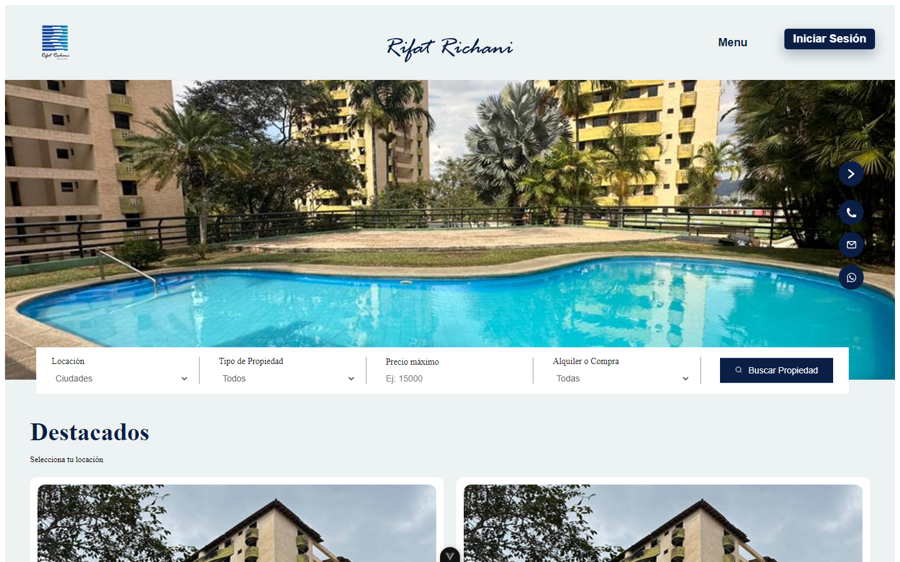

# Defensa del CRM — Rifat Richani Bienes Raíces

Resumen de los puntos para defender el proyecto: **por qué lo hicimos**, **tecnologías**, **metodología de negocio** y **cómo funciona** de punta a punta. Las capturas están en `capturas/` y son del entorno de prueba (por eso algunas tablas aparecen con pocos datos).

> Texto entre corchetes `[ ]` = completar con datos reales del equipo o del cliente.

---

## 1. El cliente y por qué hicimos el CRM

### El cliente
**Rifat Richani Bienes Raíces** es una inmobiliaria de Valencia, Carabobo, dedicada a la compra, venta y alquiler de propiedades. Según su propio portal (sección «¿Por qué nosotros?»):

| Dato | Valor |
| --- | --- |
| Años en el mercado | **24+** |
| Viviendas gestionadas | **600+** |
| Clientes atendidos | **350+** |



### Lo que nos llevó a construirlo
Con ese volumen, el trabajo comercial no se puede llevar de memoria ni en hojas sueltas. La necesidad se resumía en cuatro problemas *[ajustar con lo que contó el cliente]*:

1. **Clientes dispersos:** las consultas llegaban por WhatsApp, teléfono y correo, sin un registro único de cada interesado.
2. **Sin seguimiento:** no se sabía en qué etapa iba cada cliente ni qué vendedor lo atendía, y las oportunidades se enfriaban.
3. **Inventario sin contexto:** el portal mostraba los inmuebles, pero no decía cuáles generaban interés, visitas u ofertas.
4. **Decisiones a ciegas:** no había métricas de consultas, cierres ni rendimiento por vendedor.

### La solución
**Un solo sistema: el portal atrae al cliente y el CRM lo acompaña hasta el cierre.** El portal público y el CRM comparten la misma base de datos: cuando un cliente se registra o pide información, aparece al instante en el CRM.

---

## 2. Tecnologías

### Arquitectura en tres capas

```
 Navegador (portal + CRM)  ──►  API REST  ──►  Base de datos
 Vue 3 · TypeScript · Vite      Spring Boot 4    PostgreSQL (Supabase)
                                Java 17
                                  │
                 ┌────────────────┼────────────────┐
           Correo SMTP      Archivos (fotos       JWT (sesión
           (códigos y        y documentos)         segura)
            correos)
```

### Herramientas y para qué las usamos

| Capa | Tecnología | Para qué |
| --- | --- | --- |
| Interfaz | Vue 3 + TypeScript + Vite | Portal y CRM rápidos y con tipos |
| Navegación | Vue Router | Rutas públicas y protegidas por rol |
| Servidor | Spring Boot 4 (Java 17) | API REST y reglas de negocio |
| Datos | Spring Data JPA / Hibernate + PostgreSQL en Supabase | Persistencia y filtros dinámicos (Criteria API) |
| Seguridad | Spring Security + JWT (jjwt) + BCrypt | Sesiones, roles y contraseñas cifradas |
| Reportes | Apache POI + OpenPDF | Exportar tablas e informes a Excel y PDF |
| Correo | Spring Mail (SMTP) | Códigos de verificación y correos a clientes con adjuntos |
| Pruebas | JUnit + H2 (backend) · Vitest (frontend) | 58 pruebas backend · 35 frontend |
| Construcción | Maven · npm | Compilación y dependencias |

### Seguridad y calidad
- **Acceso por roles:** administrador, vendedor y cliente del portal. El frontend oculta lo que no corresponde y el backend vuelve a validar cada petición (por ejemplo, un vendedor no puede modificar negocios de otro).
- **Cuentas protegidas:** contraseñas con BCrypt, verificación del correo con código, recuperación de contraseña y cierre de sesión que invalida el token.
- **Base de datos versionada:** 7 migraciones SQL repetibles (`backend/backendinmobiliaria/db/migraciones`). Al arrancar, el servidor avisa en el log si falta alguna.
- **Pruebas automáticas:** 93 pruebas que ejecutan las consultas reales sobre una base en memoria (filtros, permisos, exportaciones, estadísticas).

---

## 3. Metodología de negocio

### Inbound + embudo de ventas
El proyecto sigue la metodología **inbound**: el cliente llega por su cuenta, atraído por el portal, en lugar de que el vendedor lo busque en frío. El sistema cubre las cuatro fases:

| Fase | Dónde ocurre | Qué pasa |
| --- | --- | --- |
| **1. Atraer** | Portal | Catálogo, búsqueda por filtros, fotos y mapa |
| **2. Convertir** | Registro / consulta | El visitante se registra (código al correo) o pide información: nace un **contacto** y un **lead** |
| **3. Cerrar** | Negocios, tareas, actividades | El negocio avanza por etapas con visitas, ofertas y trámites |
| **4. Medir** | Estadísticas | Qué atrae, qué convierte y quién cierra |

### El embudo: 7 etapas de cada negocio
`Prospecto → Cita/visita programada → Visita realizada → Oferta/negociación → Trámites legales → Cierre ganado | Cierre perdido`

### Principios que aplica el sistema
- **Un responsable:** cada contacto, negocio y tarea tiene un vendedor propietario (pestañas «Mis…» y «Sin asignar»).
- **Todo queda escrito:** notas, correos, llamadas, reuniones, tareas y cambios de etapa forman el historial del cliente.
- **Se mide:** monto por etapa, tasa de cierre, comportamiento del cliente frente a cada inmueble y rendimiento por vendedor.

---

## 4. Cómo funciona: del portal al CRM

### Paso 1 — El cliente en el portal
- Busca por ciudad, tipo de propiedad, precio y operación (venta o alquiler).
- Ve la ficha del inmueble: galería de fotos, precio, detalles, extras y mapa.
- Se registra y confirma su correo con un código.
- Guarda favoritos y pide información (esto crea un lead en el CRM).


### Paso 2 — Del portal al CRM, sin pasos manuales
`Se registra → aparece en «Contactos sin asignar» → un vendedor lo toma → crea un negocio con un inmueble → seguimiento hasta el cierre`

El vendedor entra por `/crm/login` (cuenta de empleado) y ve el menú del CRM. Puede cerrar sesión desde el pie de la barra lateral.


### Los módulos del CRM

#### Contactos
- Tabla con pestañas **Todos / Mis contactos / Sin asignar**, buscador, filtros (propietario, fechas, última actividad, estado del lead), filtros avanzados, edición de columnas y exportación Excel/PDF.
- **Registro del contacto** en tres columnas:
  - Izquierda: datos y propiedades, menú «Acciones» (ver todas las propiedades, crear negocio, asignar o liberar) y **accesos rápidos**: nota, correo (se envía de verdad con adjuntos), llamada (con grabación), tarea y reunión.
  - Centro: **historial continuo** filtrable por tipo; las tareas y reuniones pendientes van primero.
  - Derecha: negocios en marcha, pedidos realizados, tickets, adjuntos, leads y actividad en el portal (favoritos y vistas).


#### Negocios
- Pestañas **Todos / Mis negocios / Sin asignar**, con **vista de tabla** y **vista de tablero (pipeline)**.
- En el tablero, cada etapa es una columna. Las tarjetas se **arrastran** para cambiar de etapa y cada columna muestra el **monto acumulado**.
- Filtros: propietario, etapa, tipo de operación, tipo de inmueble, fecha de creación y fecha de cierre, más filtros avanzados (rango de valor, cliente, código).
- Página del negocio: barra de etapas, datos, inmueble con fotos, cliente e historial de seguimiento.


#### Inmuebles
- Pestañas **Todos / Mis inmuebles captados / Disponibles**.
- Tabla con código, título, tipo, operación, zona, precio, estado (disponible, reservado, vendido, alquilado), dueño y asesor captador.
- Ficha: galería, características (habitaciones, baños, m²), dueño, mapa, **documentos legales** privados, negocios y **clientes interesados**.
- «Registrar inmueble» abre el formulario de alta. Al marcarlo como vendido o alquilado, deja de aparecer en el portal.


#### Tareas
- Pestañas **Todas / Mis tareas pendientes / Completadas o vencidas**.
- Tipo (llamada, visita a inmueble, envío de catálogo/correo, reunión, trámite), estado (pendiente, en proceso, vencida, completada), prioridad, contacto, inmueble o negocio, vencimiento y propietario.
- Las tareas **vencidas se calculan solas**. Al completarla, el resultado queda como nota en el historial del cliente.


#### Estadísticas e informes
- Pestañas **Resumen general / Interacción con inmuebles / Rendimiento de ventas**.
- Tarjetas: consultas recibidas, visitas realizadas, negocios abiertos y cierres del mes.
- **Gráfica de pastel:** comportamiento del cliente frente al inmueble (solo pidió información, agendó visita, visitó, ofertó, compró o alquiló) o el tipo de inmueble más demandado. Al hacer clic en una porción se filtra el panel.
- **Gráfica de interacciones** (consultas, visitas y cierres) en el tiempo, por zona o por inmueble.
- Tabla por inmueble con clientes, visitas, ofertas y vendedor. Al abrir un inmueble se ve qué contactos interactuaron y qué hicieron.
- Rendimiento por vendedor (ganados, perdidos, monto, tasa de cierre, tareas) y **informe exportable** a Excel o PDF.


### Todo lo que se puede hacer
- Buscar y filtrar en cada tabla; editar columnas; exportar a Excel y PDF.
- Asignar clientes, negocios y tareas a vendedores.
- Enviar correos con adjuntos y registrar llamadas, notas y reuniones.
- Programar tareas con prioridad y vencimiento.
- Mover negocios por las etapas del embudo.
- Guardar documentos legales de cada inmueble.
- Medir la interacción con los inmuebles y el rendimiento de ventas.
- Entrar y salir de forma segura por rol.

---

## Preguntas que pueden hacer (y cómo responder)

| Pregunta | Respuesta corta |
| --- | --- |
| ¿Por qué no usar un CRM comercial (HubSpot, Salesforce)? | Ya existía el portal propio. Integrarlo directamente evita duplicar datos, costos por usuario y adaptar un CRM genérico a etapas inmobiliarias (visitas, trámites legales, estado del inmueble). |
| ¿Cómo se protege la información? | Roles validados en el servidor, contraseñas BCrypt, tokens JWT que se invalidan al cerrar sesión, documentos privados que solo se descargan con sesión. |
| ¿Cómo saben que funciona? | 93 pruebas automáticas que corren las consultas reales; migraciones de base de datos versionadas y verificación del esquema al arrancar. |
| ¿Qué pasa cuando un cliente se registra? | Se crea su usuario y aparece al instante en «Contactos sin asignar»; al confirmar el código pasa a «Correo verificado». |
| ¿Qué falta? | *[Completar: p. ej., módulo de tickets de servicio y calendario propio, hoy cubiertos con tareas y notas.]* |
